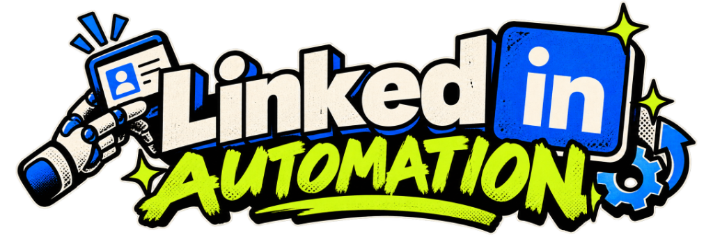

<p align="center">
  
</p>

<p align="center">
  <strong>Autonomous AI-powered LinkedIn content pipeline. Discover trending tech news, analyze insights with Claude Fable, and publish high-engagement posts on schedule via GitHub Actions.</strong>
</p>

<p align="center">
  <a href="https://github.com/farukhetro/Linkedin-automation"></a>
  <a href="LICENSE"></a>
  <a href="https://github.com/farukhetro/Linkedin-automation/actions"></a>
  <a href="https://www.anthropic.com"></a>
  <a href="https://ko-fi.com/U4B028M2CY"></a>
</p>

---

## ⚡ What is LinkedIn Automation?

Building consistency on LinkedIn takes hours of daily research, evaluation, and drafting. **LinkedIn Automation** solves this by creating an autonomous 24/7 content engine that runs 100% free inside your personal GitHub repository.

```text
┌────────────────┐     ┌────────────────┐     ┌────────────────┐     ┌────────────────┐
│   🔍 DISCOVER   │ ──> │   🧠 ANALYZE   │ ──> │   ✍️ COMPOSE   │ ──> │   📢 PUBLISH   │
│  Tavily Search │     │  Claude Fable  │     │ Custom Skills  │     │  LinkedIn API  │
└────────────────┘     └────────────────┘     └────────────────┘     └────────────────┘
```

---

## 📊 Manual Content vs. LinkedIn Automation

| Feature | Manual Process | LinkedIn Automation |
| :--- | :--- | :--- |
| **Research Time** | 45–60 mins daily scrolling news feeds | **0 seconds** (Tavily fetches live high-signal stories) |
| **Topic Selection** | Guesswork on what will perform | **Claude Fable scores viral & engagement potential** |
| **Writing Style** | Repetitive or robotic draft struggles | **Custom tone, rules, and skills from `skills/`** |
| **Hosting Cost** | Third-party SaaS ($30–$99/month) | **$0/month** (Free GitHub Actions runners) |
| **Privacy & Security**| Shared with external platforms | **100% Self-Hosted & Encrypted in GitHub Secrets** |
| **Token Maintenance**| Constant manual updates | **Long-Lived Refresh Token (No 5-day auto-rotation)** |

---

## 🔑 How to Create LinkedIn App & Get Credentials

Follow this exact step-by-step guide to set up your LinkedIn Developer Application, configure the Authorized Redirect URL, and obtain your credentials:

### Step 1: Create Your App in LinkedIn Developer Portal
1. Go to the **[LinkedIn Developer Portal](https://www.linkedin.com/developers/apps)** and sign in.
2. Click the blue **Create app** button in the top-right corner.
3. Fill in the app details:
   - **App name**: Enter any name (e.g. `LinkedIn Auto Poster` or `Content Pipeline`).
   - **LinkedIn Page**: Link your LinkedIn Company Page (LinkedIn requires a company page to create an app; if you don't have one, create a free company page at [linkedin.com/company/setup/new](https://www.linkedin.com/company/setup/new)).
   - **Privacy policy URL**: Enter any valid URL (e.g., your GitHub repo URL or website).
   - **App logo**: Upload any square PNG or JPG image.
4. Check the legal agreement checkbox and click **Create app**.

---

### Step 2: Request Required Products (Permissions)
1. In your app dashboard, click the **Products** tab.
2. Find and request access to:
   - **Share on LinkedIn** — Click **Request access** (enables `w_member_social` permission to publish posts).
   - **Sign In with LinkedIn using OpenID Connect** — Click **Request access** (enables `openid`, `profile`, `email`).
   - *(Optional for company pages)*: **Community Management API** (enables `w_organization_social`).
3. These products are usually approved automatically within seconds.

---

### Step 3: Add the Authorized Redirect URL (Exact Match Required)
1. Click the **Auth** tab in your app navigation.
2. Scroll down to the **OAuth 2.0 settings** section.
3. Under **Authorized redirect URLs for your app**, click the **Add redirect URL** (or pencil icon).
4. Put this **EXACT** redirect URL:
   ```text
   http://localhost:3000/callback
   ```
5. Click **Update** to save the URL.

> 💡 **Why this redirect URL?**  
> When you run `npm run auth`, a local lightweight server starts on your machine at `localhost:3000`. After you approve the app in your browser, LinkedIn redirects back to `http://localhost:3000/callback` with an authorization code. The local script catches this code and automatically exchanges it for your long-lived Refresh Token.

---

### Step 4: Copy Client ID & Client Secret
1. On the same **Auth** tab, scroll to **Application credentials**.
2. Copy your **Client ID**.
3. Click the eye icon next to **Client Secret** and copy your **Client Secret**.

---

### Step 5: Generate Your Refresh Token
1. In your project, create `code/.env.local` (or copy from `code/.env.example`):
   ```env
   LINKEDIN_CLIENT_ID=your_client_id_here
   LINKEDIN_CLIENT_SECRET=your_client_secret_here
   ```
2. Open your terminal and run:
   ```bash
   cd code
   npm run auth
   ```
3. The script will print an authorization link. Open this URL in your web browser.
4. Click **Allow** to authorize the application.
5. LinkedIn redirects to `http://localhost:3000/callback`, and your terminal immediately outputs your `LINKEDIN_REFRESH_TOKEN`!
6. Copy this token and add it to your GitHub Secrets.

---

### Step 6: Find Your LinkedIn Organization ID (For Company Pages)
If you publish posts to a LinkedIn Company Page:
1. Open your LinkedIn Company Page as an admin in your browser.
2. Check the URL in your browser address bar:
   ```text
   https://www.linkedin.com/company/12345678/admin/dashboard/
   ```
3. The numeric ID in the URL (e.g. `12345678`) is your **`LINKEDIN_ORGANIZATION_ID`**.

---

### 🔒 No 5-Day Auto-Rotation of Keys
- **No keys rotate every 5 days**: This pipeline does **NOT** auto-rotate or overwrite your API keys or refresh tokens every 5 days.
- The `LINKEDIN_REFRESH_TOKEN` generated via OAuth is long-lived (valid for up to 365 days / 1 year under standard LinkedIn OAuth policies).
- During each automated run, the script requests a temporary on-demand access token directly from LinkedIn using your refresh token. Your GitHub Secrets remain static, permanent, and untouched.

---

## 🗂️ Clean Modular Architecture

The repository is organized into 3 clean modules with zero root clutter:

```text
Linkedin-Automation/
├── .github/          # assets/ (logos), pages/ (GitHub Pages), workflows/, README.md, LICENSE, FUNDING.yml
├── code/             # Executable TypeScript project (src/, package.json, tsconfig.json, .gitignore)
└── skills/           # Blank directory ready for user custom skills & guidelines
```

---

## 🚀 3-Minute Quick Start

### 1. Clone & Install
```bash
git clone https://github.com/farukhetro/Linkedin-automation.git
cd Linkedin-automation/code
npm install
```

### 2. Configure Local Environment
Create `code/.env.local`:
```env
ANTHROPIC_API_KEY=your_anthropic_api_key
TAVILY_API_KEY=your_tavily_api_key
LINKEDIN_CLIENT_ID=your_linkedin_client_id
LINKEDIN_CLIENT_SECRET=your_linkedin_client_secret
LINKEDIN_REFRESH_TOKEN=your_refresh_token_from_npm_run_auth
LINKEDIN_ORGANIZATION_ID=your_company_page_id
SEARCH_QUERY="Artificial Intelligence OR Machine Learning"
```

### 3. Test Locally
```bash
npm run start
```

---

## ⚙️ GitHub Actions Automation (24/7 Autopilot)

Navigate to **Settings > Secrets and variables > Actions > New repository secret** in your GitHub repository and add:

| Secret Name | Description | Required |
| :--- | :--- | :--- |
| `ANTHROPIC_API_KEY` | Anthropic Claude API Key (Claude Fable) | Yes |
| `TAVILY_API_KEY` | Tavily Search API Key | Yes |
| `LINKEDIN_CLIENT_ID` | LinkedIn Developer App Client ID | Yes |
| `LINKEDIN_CLIENT_SECRET` | LinkedIn Developer App Client Secret | Yes |
| `LINKEDIN_REFRESH_TOKEN` | Long-lived OAuth Token from `npm run auth` | Yes |
| `LINKEDIN_ORGANIZATION_ID`| LinkedIn Company Page or Organization ID | Yes |

### Optimal Posting Windows
Configured inside `.github/workflows/cron.yml` across 5 peak engagement windows:
- `4:50 AM ET` — Commuter morning feed
- `12:59 PM ET` — Lunchtime mobile browsing
- `4:45 PM ET` — Afternoon industry wrap-up
- `7:45 PM ET` — Evening developer discussions
- `9:07 PM ET` — Late night tech community catch-up

---

## 🎯 Custom Skills (`skills/`)

The root `skills/` directory is deliberately blank so you can drop your own personal guidelines into it:
- Add `skills.txt`, `profile.json`, or `guidelines.md` with your core expertise, tone of voice, target audience, and forbidden buzzwords.
- Claude automatically detects and parses any files placed in `skills/` without requiring any code edits.

---

## ☕ Support This Open-Source Project

If this tool saves you hours of writing and research, consider buying us a coffee on Ko-fi. Your contributions keep the project actively maintained and updated with the latest AI models!

<p align="center">
  <a href="https://ko-fi.com/U4B028M2CY">
    
  </a>
</p>

---

## 📄 License

Distributed under the **MIT License**. See [LICENSE](LICENSE) for more information.
